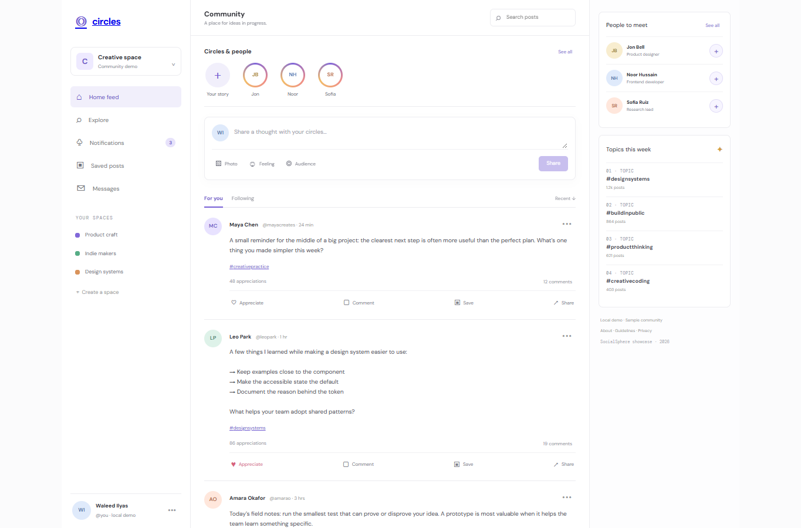

# SocialSphere

A responsive community feed concept with local post, reaction, comment, save, and follow interactions. All people and feed items are sample content.

## Run locally

From the workspace root, run `npm install`, then `npm run dev --workspace=socialsphere` and open `http://localhost:3005`. For production, run `npm run build --workspace=socialsphere` and `npm run start --workspace=socialsphere`.

## Local API

In a second terminal, run `npm run api --workspace=socialsphere` to start the Express API at `http://127.0.0.1:4105`. Check `/api/health`; `/api/posts` supports paginated reads and local post creation, and `/api/users` lists fictional users. Data persists in `server/data.json`.

## Features

- Community feed, search, saved-post filter, sample stories, and responsive layout.
- Compose local text posts or attach an image filename preview; nothing is uploaded.
- Like, save, follow, and comment interactions work in client state.
- Sample topic discovery and suggestion controls.

## Scope

The local Express API supports fictional posts and users using JSON file storage. It is not a hosted social network: there is no account system, media upload, moderation, messaging, or real-time service. Browser-only likes and comments reset on reload. The demo never represents real community activity.

## Tech stack badges

  

## Screenshots

## Environment variables

`API_PORT` is optional and defaults to `4105`. No external credentials or paid APIs are needed.
